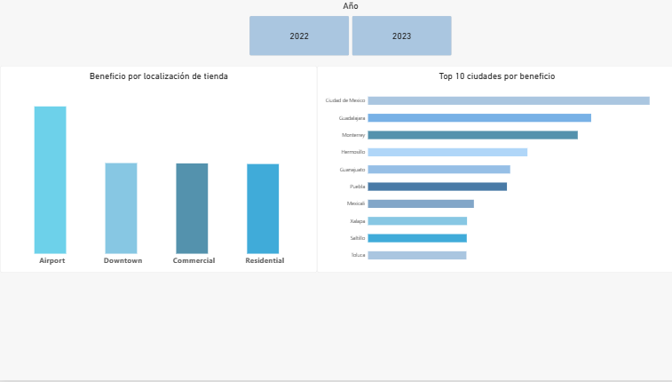
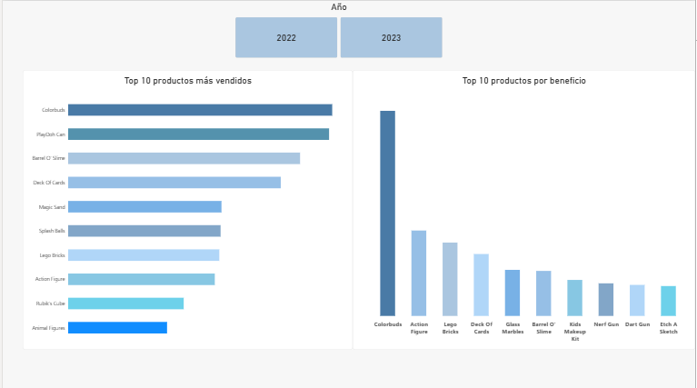

# Análisis de ventas de una cadena de jugueterías (Maven Toys)📝

Proyecto final de máster: limpieza, transformación, análisis descriptivo, análisis estadístico y dashboard operativo en Power BI sobre más de 800.000 ventas de una cadena de jugueterías de México.

**Autoría:** Carla López Silvestre 
**Repositorio:** (https://github.com/Carla-LopezSilvestre/Proyecto_final.git)  
**Herramientas:** Python (pandas, scipy), Visual Studio Code, Power BI Desktop

---

## Índice

1. [Descripción y objetivo](#1-descripción-y-objetivo)
2. [Preguntas de negocio](#2-preguntas-de-negocio)
3. [Fuentes de datos y requisitos del proyecto](#3-fuentes-de-datos-y-requisitos-del-proyecto)
4. [Estructura del repositorio](#4-estructura-del-repositorio)
5. [Cómo reproducir el proyecto](#5-cómo-reproducir-el-proyecto)
6. [Proceso seguido paso a paso](#6-proceso-seguido-paso-a-paso)
7. [Diccionario de datos del dataset final](#7-diccionario-de-datos-del-dataset-final)
8. [Análisis descriptivo](#8-análisis-descriptivo)
9. [Análisis estadístico](#9-análisis-estadístico)
10. [Dashboard en Power BI](#10-dashboard-en-power-bi)
11. [Conclusiones](#11-conclusiones)
12. [Recomendaciones](#12-recomendaciones)
13. [Limitaciones](#13-limitaciones)
14. [Créditos y licencias](#14-créditos-y-licencias)

---

## 1. Descripción y objetivo

Maven Toys es una cadena ficticia de jugueterías con 50 tiendas repartidas por 29 ciudades de México. Maven Analytics publica sus datos para practicar análisis de datos. El conjunto cubre desde el **1 de enero de 2022 hasta el 30 de septiembre de 2023** y registra cada venta con su fecha, tienda, producto y unidades.

El objetivo del proyecto es responder, con datos, a preguntas típicas de un departamento de ventas: qué se vende, dónde, cuándo y con qué rentabilidad. Para ello se combinan los datos de ventas con el catálogo de productos y la información de las tiendas, se limpian y se transforman, se analizan descriptiva y estadísticamente, y se resumen en un dashboard.

## 2. Preguntas de negocio

1. ¿Cuánto vende y cuánto gana la cadena, y con qué margen?
2. ¿Qué categorías de producto generan más ingresos y cuáles más beneficio?
3. ¿Cómo evolucionan las ventas a lo largo del tiempo? ¿Hay estacionalidad?
4. ¿Se vende más en fin de semana que entre semana?
5. ¿Qué tipos de ubicación y qué ciudades rinden más?
6. ¿Las tiendas de aeropuerto rinden más que las demás?
7. ¿Las tiendas más antiguas ganan más?
8. ¿El precio de un producto explica cuántas unidades se venden?
9. ¿Qué productos son los más vendidos y cuáles los más rentables?

## 3. Fuentes de datos y requisitos del proyecto

### Fuentes

| | Fuente A | Fuente B |
|---|---|---|
| **Archivo** | `data/raw/sales.csv` | `data/raw/maestro_tiendas_productos.xlsx` |
| **Formato** | CSV | Excel (dos hojas: `productos` y `tiendas`) |
| **Contenido** | 829.262 ventas (`Sale_ID`, `Date`, `Store_ID`, `Product_ID`, `Units`) | 35 productos y 50 tiendas |
| **Origen** | Maven Analytics, dataset *Mexico Toy Sales* | Maven Analytics, a partir de `products.csv` y `stores.csv` |

**Cómo se unen:** ventas con productos por `Product_ID`, y ventas con tiendas por `Store_ID`. Son claves numéricas y no hace falta normalizar nombres.

**Nota de transparencia sobre las fuentes:** los datos originales de Maven Analytics se publican en seis archivos CSV (`sales`, `products`, `stores`, `inventory`, `calendar` y `data_dictionary`), todos del mismo proveedor y todos en CSV. Para trabajar con **dos formatos distintos** (CSV y Excel), el archivo `maestro_tiendas_productos.xlsx` fue generado por la autora del proyecto a partir de `products.csv` y `stores.csv`, uno por hoja, sin modificar su contenido. El código que lo crea está en `notebooks/01_exploracion.ipynb`. Los CSV originales se conservan sin tocar en `data/raw`. Los archivos `inventory.csv` y `calendar.csv` están incluidos como parte de la descarga original, pero no se han utilizado en el análisis.

### Cumplimiento de los requisitos mínimos

| Requisito | Cómo se cumple |
|---|---|
| Dos conjuntos de datos en bruto | `sales.csv` (CSV) y `maestro_tiendas_productos.xlsx` (Excel), en `data/raw` |
| Dataset final de al menos 50.000 filas y 20 columnas | **829.262 filas y 24 columnas** (`data/processed/dataset_final.csv.gz`) |
| Transformaciones sobre los datos | Conversión de tipos, corrección de una errata, unión y 11 columnas derivadas |
| Análisis exhaustivo | Análisis descriptivo y cuatro contrastes estadísticos (secciones 8 y 9) |
| Dashboard operativo | Power BI de tres páginas, en `dashboard/` |
| Informe del análisis | Secciones 8 a 13 de este documento |
| README con los pasos seguidos | Este archivo |
| Buena organización del repositorio | Sección 4 |

## 4. Estructura del repositorio

```
maven-toys-analysis/
├── data/
│   ├── raw/                              # Datos originales, sin modificar
│   │   ├── sales.csv
│   │   ├── products.csv
│   │   ├── stores.csv
│   │   ├── inventory.csv
│   │   ├── calendar.csv
│   │   ├── data_dictionary.csv
│   │   └── maestro_tiendas_productos.xlsx
│   └── processed/
│       └── dataset_final.csv.gz          # Dataset final limpio y unido
├── notebooks/
│   ├── 01_exploracion.ipynb              # Lectura, tipos, calidad y creación del Excel
│   ├── 02_limpieza_y_union.ipynb         # Limpieza, unión, columnas derivadas y guardado
│   └── 03_analisis_descriptivo.ipynb     # Análisis descriptivo y contrastes estadísticos
├── dashboard/
│   └── Dashboard_Maven_Toys.pbix         # Dashboard de Power BI
├── Images/                               # Capturas del dashboard
├── reports/
├── requirements.txt
├── .gitignore
└── README.md
```

**Sobre el tamaño del dataset final:** el CSV sin comprimir pesa unos 144 MB, por encima del límite de 100 MB de GitHub. Por eso el repositorio incluye `dataset_final.csv.gz` (unos 8 MB), que pandas lee directamente con `pd.read_csv`. El CSV sin comprimir se genera en local al ejecutar el notebook 02 y está excluido en `.gitignore`. Es el que se carga en Power BI.

## 5. Cómo reproducir el proyecto

1. Clonar el repositorio y entrar en la carpeta del proyecto.
2. Crear y activar un entorno virtual:

   ```bash
   python -m venv .venv
   .venv\Scripts\activate          # en Mac/Linux: source .venv/bin/activate
   ```

   En Windows, si PowerShell bloquea la activación, ejecutar una vez
   `Set-ExecutionPolicy -Scope CurrentUser -ExecutionPolicy RemoteSigned`.

3. Instalar las dependencias:

   ```bash
   pip install -r requirements.txt
   ```

4. Comprobar que los datos están en `data/raw`. Si no, descargarlos de Maven Analytics (*Data Playground*, dataset *Mexico Toy Sales*).
5. Ejecutar los notebooks en este orden: `01_exploracion`, `02_limpieza_y_union` y `03_analisis_descriptivo`. El notebook 02 genera `dataset_final.csv` y `dataset_final.csv.gz` en `data/processed`.
6. Abrir `dashboard/Dashboard_Maven_Toys.pbix` con Power BI Desktop. Si hay que volver a cargar los datos, ver la nota sobre decimales en la sección 10.

`requirements.txt`: pandas, numpy, openpyxl, matplotlib, seaborn, scipy, statsmodels, ipykernel.

## 6. Proceso seguido paso a paso🧾

### 6.1. Exploración inicial (`01_exploracion.ipynb`)

Se leyeron los tres archivos principales y se revisaron sus dimensiones y tipos de dato:

| Tabla | Filas | Columnas |
|---|---|---|
| `sales` | 829.262 | 5 |
| `products` | 35 | 5 |
| `stores` | 50 | 5 |

Controles de calidad realizados:

- **Valores vacíos:** ninguno en ninguna de las tres tablas.
- **Filas duplicadas:** ninguna en ninguna de las tres tablas.
- **Rango de fechas de las ventas:** del 01/01/2022 al 30/09/2023.
- **Unidades por venta:** media de 1,32, mediana de 1 y máximo de 30. La gran mayoría de las ventas son de una sola unidad.
- **Productos por categoría:** Toys 9, Art & Crafts 8, Games 8, Sports & Outdoors 7 y Electronics 3.
- **Tiendas por tipo de ubicación:** Downtown 29, Commercial 12, Residential 6 y Airport 3.

En este mismo notebook se generó el Excel `maestro_tiendas_productos.xlsx` y se comprobó leyéndolo de vuelta (hojas `productos` con 35 filas y `tiendas` con 50).

### 6.2. Limpieza y transformación (`02_limpieza_y_union.ipynb`)

Los datos de partida estaban muy limpios, así que la limpieza se centró en tres problemas reales:

1. **Fechas guardadas como texto.** `Date` (ventas) y `Store_Open_Date` (tiendas) se convirtieron a tipo fecha, para poder agrupar por mes, trimestre o día de la semana.
2. **Precios guardados como texto.** `Product_Cost` y `Product_Price` venían con el símbolo `$` y un espacio al final (por ejemplo `"$15.99 "`). Se eliminaron el `$` y los espacios, y se convirtieron a número decimal. Sin este paso no se podría calcular ingresos ni beneficio.
3. **Errata en un nombre de ciudad.** En la tabla de tiendas aparecía `Cuidad de Mexico` en lugar de `Ciudad de Mexico`, y afectaba a las 4 tiendas de esa ciudad. Se corrigió en el notebook, y los archivos de `data/raw` se mantuvieron sin tocar.

### 6.3. Unión de las fuentes

Se partió de la tabla de ventas y se le añadieron los datos del producto (`Product_ID`) y de la tienda (`Store_ID`) con uniones de tipo *left*, que conservan todas las ventas.

- Filas antes de unir: 829.262.
- Filas después de unir: 829.262.
- Columnas tras la unión: 13 (5 de ventas + 4 de productos + 4 de tiendas).
- Valores vacíos tras unir: ninguno, lo que confirma que todos los productos y tiendas de las ventas existen en sus tablas.

### 6.4. Variables derivadas

Se crearon 11 columnas nuevas, que llevan el dataset de 13 a 24 columnas:

- **Dinero:** `Total_Revenue`, `Total_Cost`, `Profit` y `Margin_Pct`.
- **Tiempo:** `Year`, `Month`, `Month_Name`, `Quarter`, `Weekday` e `Is_Weekend`.
- **Tienda:** `Store_Age_Years`, la antigüedad de la tienda en años en el momento de la venta.

### 6.5. Dataset final

El resultado se guardó en `data/processed/dataset_final.csv.gz` (para el repositorio) y `data/processed/dataset_final.csv` (para Power BI, ignorado por Git). Tiene **829.262 filas y 24 columnas**. Una comprobación posterior confirmó que la errata `Cuidad de Mexico` ya no aparece en el dataset final.

## 7. Diccionario de datos del dataset final

| Columna | Tipo | Descripción | Origen |
|---|---|---|---|
| `Sale_ID` | Entero | Identificador de la venta | Ventas (CSV) |
| `Date` | Fecha | Fecha de la venta | Ventas (CSV) |
| `Store_ID` | Entero | Identificador de la tienda | Ventas (CSV) |
| `Product_ID` | Entero | Identificador del producto | Ventas (CSV) |
| `Units` | Entero | Unidades vendidas en la venta | Ventas (CSV) |
| `Product_Name` | Texto | Nombre del producto | Excel, hoja `productos` |
| `Product_Category` | Texto | Categoría del producto | Excel, hoja `productos` |
| `Product_Cost` | Decimal | Coste unitario en dólares | Excel, hoja `productos` |
| `Product_Price` | Decimal | Precio de venta unitario en dólares | Excel, hoja `productos` |
| `Store_Name` | Texto | Nombre de la tienda | Excel, hoja `tiendas` |
| `Store_City` | Texto | Ciudad de la tienda | Excel, hoja `tiendas` |
| `Store_Location` | Texto | Tipo de ubicación (Downtown, Commercial, Residential, Airport) | Excel, hoja `tiendas` |
| `Store_Open_Date` | Fecha | Fecha de apertura de la tienda | Excel, hoja `tiendas` |
| `Total_Revenue` | Decimal | Ingresos de la venta: `Units × Product_Price` | Derivada |
| `Total_Cost` | Decimal | Coste de la venta: `Units × Product_Cost` | Derivada |
| `Profit` | Decimal | Beneficio: `Total_Revenue − Total_Cost` | Derivada |
| `Margin_Pct` | Decimal | Margen de la venta en %: `Profit / Total_Revenue × 100` | Derivada |
| `Year` | Entero | Año de la venta | Derivada |
| `Month` | Entero | Mes de la venta (1 a 12) | Derivada |
| `Month_Name` | Texto | Nombre del mes | Derivada |
| `Quarter` | Entero | Trimestre (1 a 4) | Derivada |
| `Weekday` | Texto | Día de la semana | Derivada |
| `Is_Weekend` | Booleano | `True` si es sábado o domingo | Derivada |
| `Store_Age_Years` | Decimal | Antigüedad de la tienda en años en la fecha de la venta | Derivada |

## 8. Análisis descriptivo

### 8.1. Cifras generales

| Indicador | Valor |
|---|---|
| Ventas (filas) | 829.262 |
| Unidades vendidas | 1.090.565 |
| Ingresos totales | 14.444.572,35 $ |
| Beneficio total | 4.014.029 $ |
| Margen global | 27,79 % |

Los importes están en dólares, tal y como figuran en los datos originales.

### 8.2. Por categoría de producto

| Categoría | Ingresos ($) | Beneficio ($) | Unidades | Margen |
|---|---|---|---|---|
| Toys | 5.093.241,00 | 1.079.527 | 267.200 | 21,20 % |
| Electronics | 2.246.771,25 | 1.001.437 | 134.075 | 44,57 % |
| Art & Crafts | 2.705.364,26 | 753.354 | 325.574 | 27,85 % |
| Games | 2.226.836,27 | 673.993 | 194.673 | 30,27 % |
| Sports & Outdoors | 2.172.359,57 | 505.718 | 169.043 | 23,28 % |

**Lectura:** vender más no equivale a ganar más.

- **Toys** es la categoría que más ingresa (el 35 % del total) y la que más beneficio da, pero con un margen bajo, del 21,2 %. Gana por volumen.
- **Electronics** solo aporta el 16 % de los ingresos, pero el 25 % del beneficio, porque tiene con diferencia el mejor margen (44,6 %), y eso con solo tres productos. Gana por margen.
- Entre Toys y Electronics suman algo más de la mitad del beneficio total (52 %).
- **Sports & Outdoors** es la categoría que menos beneficio deja, con un margen del 23,3 %.

### 8.3. Por tipo de ubicación

| Ubicación | Tiendas | Ingresos ($) | Beneficio ($) | Beneficio por tienda ($) |
|---|---|---|---|---|
| Downtown | 29 | 8.219.596,27 | 2.248.728 | 77.542 |
| Commercial | 12 | 3.279.139,52 | 926.864 | 77.239 |
| Residential | 6 | 1.656.113,98 | 460.388 | 76.731 |
| Airport | 3 | 1.289.722,58 | 378.049 | 126.016 |

**Lectura:** Downtown aporta el 56 % del beneficio, pero solo porque concentra 29 de las 50 tiendas. Por tienda, Downtown, Commercial y Residential rinden prácticamente igual (en torno a 77.000 $). **Las tiendas de Airport destacan**, con 126.000 $ por tienda, un 63 % más. Ver en la sección 9 si esa diferencia se puede confirmar estadísticamente.

### 8.4. Por ciudad (cinco primeras por beneficio)

| Ciudad | Beneficio ($) | Tiendas |
|---|---|---|
| Ciudad de Mexico | 465.558 | 4 |
| Guadalajara | 368.930 | 4 |
| Monterrey | 346.729 | 4 |
| Hermosillo | 263.608 | 3 |
| Guanajuato | 235.047 | 3 |

**Lectura:** las cuatro primeras ciudades coinciden con las que más tiendas tienen, así que parte de su liderazgo se debe al número de tiendas y no solo a que cada tienda venda más.

### 8.5. Evolución mensual del beneficio

| Mes | 2022 ($) | 2023 ($) |
|---|---|---|
| Enero | 167.126 | 205.074 |
| Febrero | 161.861 | 189.314 |
| Marzo | 173.992 | 231.909 |
| Abril | 190.099 | 215.096 |
| Mayo | 186.894 | 210.347 |
| Junio | 189.815 | 207.212 |
| Julio | 176.922 | 209.807 |
| Agosto | 158.931 | 175.038 |
| Septiembre | 166.397 | 180.445 |
| Octubre | 178.799 | — |
| Noviembre | 192.873 | — |
| Diciembre | 246.078 | — |

**Lectura:**

- **Pico de diciembre de 2022** (246.078 $), compatible con la campaña de Navidad.
- **Bajón en agosto y septiembre** en los dos años.
- **Crecimiento interanual:** comparando solo enero a septiembre, el beneficio de 2023 (1,82 millones) es un **16 % mayor** que el de 2022 (1,57 millones).

### 8.6. Productos

**Más vendidos (unidades):**

| Producto | Categoría | Precio ($) | Unidades |
|---|---|---|---|
| Colorbuds | Electronics | 14,99 | 104.368 |
| PlayDoh Can | Art & Crafts | 2,99 | 103.128 |
| Barrel O' Slime | Art & Crafts | 3,99 | 91.663 |
| Deck Of Cards | Games | 6,99 | 84.034 |
| Magic Sand | Art & Crafts | 15,99 | 60.598 |

**Menos vendidos (unidades):**

| Producto | Categoría | Precio ($) | Unidades |
|---|---|---|---|
| Mini Basketball Hoop | Sports & Outdoors | 24,99 | 2.647 |
| Uno Card Game | Games | 7,99 | 2.710 |
| Monopoly | Games | 19,99 | 3.385 |
| Chutes & Ladders | Games | 12,99 | 3.829 |
| Playfoam | Art & Crafts | 10,99 | 4.158 |

**Más rentables (beneficio, aproximado):**

| Producto | Beneficio ($) |
|---|---|
| Colorbuds | 834.944 |
| Action Figure | 347.748 |
| Lego Bricks | 298.685 |
| Deck Of Cards | 252.102 |
| Glass Marbles | 187.590 |

**Lectura:** Colorbuds es el número uno en las dos listas y genera por sí solo en torno al 21 % del beneficio total. En cambio, PlayDoh Can y Magic Sand están entre los más vendidos pero no entre los más rentables: venden mucho pero dejan poco por unidad.

## 9. Análisis estadístico

### Cómo leer un p-valor

El **p-valor** es la probabilidad de observar una diferencia (o relación) al menos tan grande como la encontrada **si en realidad no existiera ninguna**. Se compara con un umbral, habitualmente 0,05:

- **p menor que 0,05:** es muy poco probable que la diferencia sea casualidad. Se considera estadísticamente significativa.
- **p mayor que 0,05:** la diferencia podría deberse al azar, y no se puede afirmar que sea real. Eso no demuestra que no exista, solo que con estos datos no se puede confirmar.

### Resumen de contrastes

| Pregunta | Prueba | Resultado | p-valor | Conclusión |
|---|---|---|---|---|
| ¿Se vende más en fin de semana? | t de Welch sobre ingresos diarios | 25.191 $/día frente a 21.615 $/día (+16,5 %); t = 4,756 | 0,0000032 | **Diferencia significativa** |
| ¿Rinden más las tiendas de aeropuerto? | t de Welch sobre beneficio por tienda | 126.016 $ frente a 77.361 $; t = 2,009 | 0,18 | No significativa |
| ¿Las tiendas más antiguas ganan más? | Correlación de Pearson | r = −0,064 | 0,66 | **Sin relación** |
| ¿El precio explica las unidades vendidas? | Correlación de Spearman | rho = −0,218 | 0,21 | No significativa |

### Interpretación de cada contraste

**1. Fin de semana frente a entre semana.** Se compararon los ingresos totales de cada día: 183 días de fin de semana y 455 entre semana. La probabilidad de ver una diferencia tan grande por casualidad es de unas tres millonésimas, así que el efecto es real: los días de fin de semana venden un 16,5 % más. El gráfico por día de la semana del dashboard matiza el resultado: las ventas crecen desde el jueves y alcanzan el máximo el sábado, mientras que el domingo cae a niveles de entre semana. El efecto del fin de semana lo mueve sobre todo el sábado.

**2. Aeropuerto frente al resto.** Las 3 tiendas de aeropuerto ganan de media un 63 % más que las otras 47, pero el p-valor es 0,18: habría un 18 % de probabilidad de ver una diferencia así por azar. Con solo tres tiendas, una única tienda excepcional inclina la media, así que la muestra es demasiado pequeña para confirmar la diferencia. Es una pista que merece más datos, no una conclusión firme.

**3. Antigüedad y beneficio.** La correlación es prácticamente cero (r = −0,064) y no es significativa. Que una tienda sea más antigua no la hace ganar más ni menos.

**4. Precio y unidades vendidas.** Se usó la correlación de Spearman, que tolera valores extremos, sobre los 35 productos. Hay una ligera tendencia a que los productos más caros se vendan menos (rho = −0,22), pero no es significativa (p = 0,21) y no puede afirmarse con estos datos.

**Nota:** que tres de los cuatro contrastes no resulten significativos no es un fallo del análisis. Es un resultado, y aporta credibilidad..

## 10. Dashboard en Power BI📊

Archivo: [`dashboard/Dashboard_Maven_Toys.pbix`](dashboard/Dashboard_Maven_Toys.pbix). Se alimenta del `dataset_final.csv` y tiene tres páginas, con un filtro por año sincronizado en todas ellas.

### Página 1: Resumen


- **Cuatro tarjetas:** ingresos totales, beneficio total, unidades vendidas y margen global.
- **Beneficio mensual, 2022 frente a 2023:** gráfico de líneas que compara las dos temporadas y muestra la estacionalidad (pico de diciembre, bajón de agosto y septiembre).
- **Beneficio por categoría de producto:** barras que muestran qué categorías generan más beneficio.
- **Beneficio por día de la semana:** columnas de lunes a domingo, que enseñan el efecto del fin de semana.
- **Filtros:** año y tipo de tienda, que actualizan todos los gráficos y tarjetas de la página.
- **Nota de fuentes:** un texto con el origen de los datos y el periodo cubierto.

### Página 2: Tiendas



- **Beneficio medio por tienda según ubicación:** columnas que permiten comparar tipos de ubicación con distinto número de tiendas (Airport destaca).
- **Top 10 ciudades por beneficio:** barras de las diez ciudades que más ganan.
- **Filtro por año.**

### Página 3: Producto



- **Top 10 productos más vendidos:** barras por unidades.
- **Top 10 productos por beneficio:** barras por beneficio, para comparar con la anterior y ver que más ventas no significa más beneficio.
- **Filtro por año.**

### Medidas y columnas creadas en Power BI

```DAX
Margen % = DIVIDE(SUM(dataset_final[Profit]), SUM(dataset_final[Total_Revenue]))

Beneficio por tienda = DIVIDE(SUM(dataset_final[Profit]), DISTINCTCOUNT(dataset_final[Store_ID]))

Año = YEAR(dataset_final[Date])

DiaSemana = WEEKDAY(dataset_final[Date], 2)
```

- `Margen %` es una medida y no un promedio de `Margin_Pct`: el promedio de los márgenes de cada venta (31,2 %) no coincide con el margen real de la empresa (27,79 %).
- `Beneficio por tienda` permite comparar ubicaciones con distinto número de tiendas.
- `Año` se creó porque Power BI interpretó `Year` como fecha y mostraba la leyenda con fechas largas.
- `DiaSemana` sirve para ordenar `Weekday` de lunes a domingo, en lugar de alfabéticamente.

### Problema encontrado: decimales en Power BI

El CSV usa el punto como separador decimal (por ejemplo `12.99`). Con Windows configurado en español, Power BI interpreta el punto como separador de miles y puede cargar `12.99` como `1299`, multiplicando por 100 todos los importes sin mostrar ningún error. La solución es, en Power Query, seleccionar las columnas decimales (`Product_Cost`, `Product_Price`, `Total_Revenue`, `Total_Cost`, `Profit`, `Margin_Pct` y `Store_Age_Years`) y cambiar su tipo con **Usar configuración regional**, eligiendo **Número decimal** e **Inglés (Estados Unidos)**. Tras el cambio, las cifras del dashboard coinciden con las calculadas en Python (14,44 millones de ingresos y 4,01 millones de beneficio).

## 11. Conclusiones📄

1. **La cadena tiene un margen global del 27,8 %**, con 14,4 millones de dólares de ingresos y 4,0 millones de beneficio en 21 meses.
2. **Hay dos motores de beneficio distintos.** Toys gana por volumen (35 % de los ingresos, margen del 21 %) y Electronics por margen (44,6 % con solo tres productos).
3. **El negocio es estacional.** Hay un pico claro en diciembre y un bajón en agosto y septiembre en los dos años.
4. **El negocio crece:** el beneficio de enero a septiembre de 2023 es un 16 % mayor que el del mismo periodo de 2022.
5. **El fin de semana vende significativamente más** (+16,5 %, p < 0,001), con el máximo el sábado y una caída el domingo.
6. **El tipo de ubicación apenas importa por tienda**, salvo Airport, que parece rendir más pero no se puede confirmar con tres tiendas.
7. **La antigüedad de la tienda no explica el beneficio.**
8. **El precio no explica de forma significativa las unidades vendidas.**
9. **Colorbuds concentra en torno al 21 % del beneficio total.** Es el producto estrella, pero también un punto de dependencia.

## 12. Recomendaciones

Las recomendaciones se basan en los resultados anteriores y deben tomarse con las limitaciones de la sección 13 en mente.

1. **Aprovechar la categoría Electronics.** Con un margen del 44,6 %, cada dólar vendido deja casi el doble que en Toys. Ampliar su gama (hoy son solo tres productos) o darle más visibilidad en tienda podría aumentar el beneficio sin necesitar más volumen.
2. **Revisar costes y precios en Toys y Sports & Outdoors.** Sus márgenes (21,2 % y 23,3 %) están por debajo de la media. Negociar costes con proveedores o ajustar precios en los productos más vendidos tendría un efecto grande, porque Toys mueve más de un tercio de los ingresos.
3. **Reducir la dependencia de Colorbuds.** Un solo producto genera en torno al 21 % del beneficio. Conviene vigilar su stock y precio, y trabajar un segundo producto de alto margen.
4. **Preparar la campaña de Navidad con antelación.** Diciembre es el mes más fuerte, así que asegurar stock en noviembre y diciembre evita perder ventas en el pico.
5. **Planificar acciones en agosto y septiembre.** Es el periodo flojo en los dos años. Una promoción o un lanzamiento en esas fechas podría compensarlo.
6. **Reforzar los jueves, viernes y sábados.** Son los días fuertes, así que conviene concentrar personal y reposición de producto en ellos.
7. **Estudiar con más datos el formato aeropuerto.** Las tres tiendas de aeropuerto rinden un 63 % más, pero con tan pocas la diferencia no es concluyente. Antes de abrir más, conviene hacer un seguimiento de cómo evolucionan, o una prueba piloto.
8. **Revisar la gama de baja rotación.** Mini Basketball Hoop, Uno Card Game y Monopoly son de los menos vendidos. Habría que decidir si interesa mantenerlos, ajustar su precio o reducir su stock.
9. **No basar las decisiones de precio solo en la antigüedad de las tiendas ni en el precio de los productos.** Los datos no encuentran una relación significativa con el beneficio ni con las unidades vendidas. Si se quiere saber el efecto real de un cambio de precio, haría falta una prueba controlada.

## 13. Limitaciones

- **Datos ficticios.** Maven Toys es una cadena inventada para practicar, así que los patrones pueden no reflejar el comportamiento de un negocio real.
- **Periodo corto.** Hay 21 meses, y solo 2022 tiene un año completo, por lo que la estacionalidad se apoya en un único ciclo anual completo.
- **Muestras pequeñas en algunos contrastes.** El contraste de aeropuerto compara 3 tiendas con 47, y el de precio y unidades usa 35 productos. Con tan pocas observaciones, los tests tienen poca capacidad de detectar diferencias reales.
- **Correlación no es causalidad.** Un resultado no significativo no demuestra que no haya efecto, y uno significativo no explica por qué ocurre.
- **Contrastes múltiples.** Se hicieron cuatro pruebas sin corregir el nivel de significación. Con pocas pruebas el riesgo es bajo, pero conviene tenerlo en cuenta.
- **Datos no utilizados.** Las tablas `inventory.csv` y `calendar.csv` no se han incorporado al análisis, así que no se han estudiado el stock ni las fechas especiales.
- **Moneda.** Los importes están en dólares, tal y como vienen en los datos, aunque las tiendas están en México.
- **Fuente B generada por la autora.** El Excel se creó a partir de los CSV originales para disponer de dos formatos, y por eso las dos fuentes comparten proveedor.

## 14. Créditos y licencias

- **Datos:** Maven Analytics, *Mexico Toy Sales* (Maven Data Playground). Según indica Maven Analytics en la página del dataset, los datos son de dominio público.
- **Herramientas:** Python, pandas, SciPy, Visual Studio Code y Microsoft Power BI Desktop.
- **Autoría del análisis, del Excel de productos y tiendas y del dashboard:** Carla López Silvestre.
